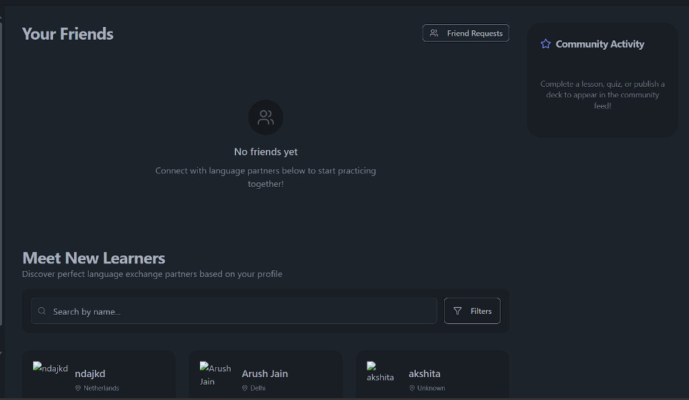
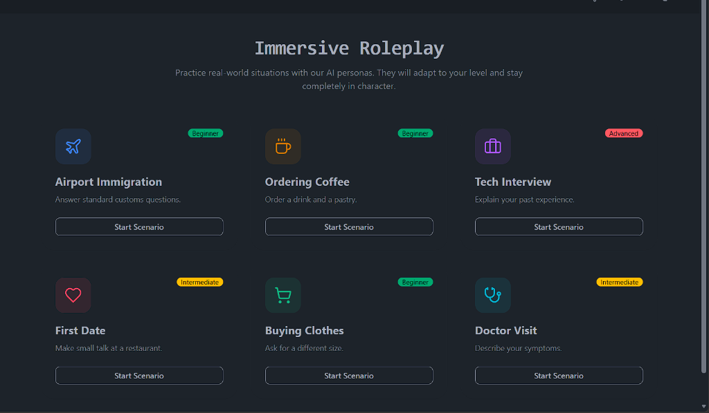
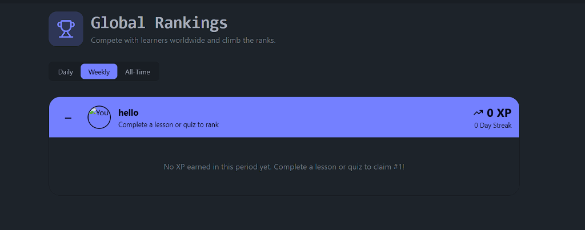
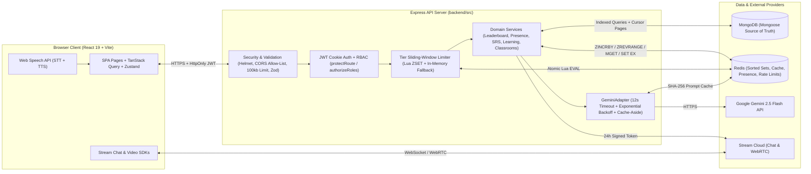

# Duffy

Full-stack language learning platform combining spaced-repetition flashcards, CEFR-adaptive Gemini AI coaching, Stream video/chat exchange, classroom management, and a Redis sorted-set & cache-aside performance layer.

**Live App:** [https://duffy.onrender.com/](https://duffy.onrender.com/)

---

## Screenshots & Demo

> Placeholder paths for UI captures — see checklist below.

| Home & Partner Discovery | AI Roleplay & Coaching |
| :---: | :---: |
|  |  |

| Global Leaderboard (Redis Sorted Sets) | Spaced-Repetition Review & Teacher Hub |
| :---: | :---: |
|  |  |

**Demo GIF:** `docs/screenshots/duffy-walkthrough.gif`

### Screenshot Capture TODO
- [ ] `docs/screenshots/home-discovery.png` — Home page showing online presence badges on Friend Cards, language filters, and the right-hand Community Activity feed.
- [ ] `docs/screenshots/ai-roleplay.png` — Roleplay session with CEFR level selector, Web Speech microphone input, and in-chat AI Grammar/Translation sidebar.
- [ ] `docs/screenshots/leaderboard.png` — Global Leaderboard displaying Daily / Weekly / All-Time tabs, caller rank highlight bar, and cursor-paginated rankings.
- [ ] `docs/screenshots/flashcards-srs.png` — Flashcard deck view and SM-2 flip-card review screen (`Again` / `Hard` / `Good` / `Easy` grading).
- [ ] `docs/screenshots/teacher-classroom.png` — Teacher Hub showing a 6-character classroom join code, student XP/streak roster, CSV export, and assignment creation modal.
- [ ] `docs/screenshots/duffy-walkthrough.gif` — 20-second loop: check grammar in chat -> complete AI quiz -> watch XP increment on Leaderboard.

---

## Architecture

Duffy runs as a single deployable Node.js/Express service (serving the built React/Vite SPA alongside `/api/*` and `/health` in production) backed by **MongoDB** as the system of record, **Redis** (`ioredis`) as an optional acceleration and coordination layer with automatic fallback, **Google Gemini (`gemini-2.5-flash`)** for language intelligence, and **Stream** for real-time 1:1 messaging and WebRTC video calls.



For a full endpoint-by-endpoint and schema inventory, see [`docs/ARCHITECTURE_AUDIT.md`](docs/ARCHITECTURE_AUDIT.md).

---

## Key Design Decisions

### 1. Redis Sorted Sets for the Leaderboard (with MongoDB Durability)
Computing a user's global rank and top-$K$ slice in MongoDB requires sorting `LearningProfile` / `Leaderboard` collections plus a separate `countDocuments({ xp: { $gt: callerXp } })` scan on every page view. Moving active rankings (`DAILY`, `WEEKLY`, `MONTHLY`, `ALL_TIME`) to Redis Sorted Sets turns XP awards into `ZINCRBY` ($O(\log N)$) and reads into a single pipelined round-trip (`ZREVRANGE` + `ZCARD` + `ZREVRANK` + `ZSCORE`) paired with `MGET` user summary hydration. MongoDB remains the durable source of truth: every XP award bulk-writes to MongoDB first, cold keys lazy-warm automatically after a Redis restart, and `npm run rebuild:leaderboard` atomically rebuilds all sorted sets via temporary keys + `RENAME`. If `REDIS_URL` is unset or unreachable, `LeaderboardService` falls back transparently to indexed MongoDB cursor queries.

### 2. Tier-Based Sliding-Window Rate Limiting on Gemini Endpoints
LLM endpoints carry real per-token cost and strict upstream provider quotas (`gemini-2.5-flash` enforces tight RPM ceilings on free tiers) that flat IP-based limiters handle poorly behind shared NATs. `createTierRateLimiter` resolves the authenticated caller's subscription tier (`FREE`: 10 / 15m, `PREMIUM`: 60 / 15m, `PRO`: 300 / 15m, cached for 5 minutes) and executes an atomic Lua sliding-window script over a per-user Redis ZSET (`ZREMRANGEBYSCORE` + `ZCARD` + `ZADD` + `PEXPIRE`). Exceeding the budget returns HTTP `429` with `Retry-After` and `X-RateLimit-*` headers; if Redis is offline, middleware degrades cleanly to a bounded in-memory sliding window.

### 3. Cache-Aside for Repeatable Gemini Prompts
Learners frequently submit identical short phrases, common grammar mistakes, and vocabulary lookups. Deterministic AI calls (`GrammarService`, `VocabularyService`, `TranslationService`, `VoiceAnalysisService`, and topic/level `QuizEngine` generation) hash normalized `(input, sourceLanguage, targetLanguage)` parameters with SHA-256 (`cache:ai:<domain>:<sha256>`) and store parsed JSON responses in Redis for 24 hours (`X-Cache: HIT | MISS`). Multi-turn conversational roleplay and SSE explanations are intentionally excluded from caching because context changes every turn. Hot read endpoints (`GET /api/decks`, `GET /api/learning/dashboard`, `GET /api/users/friends`) also use short-TTL cache-aside with explicit key invalidation on writes.

### 4. Role-Based Access Control (RBAC)
Authentication uses 7-day `HttpOnly`, `SameSite=Strict` JWT cookies verified in `protectRoute` (with `password` excluded at the Mongoose schema level via `select: false`). Authorization separates account roles (`USER`, `PREMIUM`, `TEACHER`, `ADMIN`) from billing entitlements: `authorizeRoles("TEACHER", "ADMIN")` guards classroom creation, roster inspection, and assignment management on `/api/classrooms/*` (mirrored by route guards in `App.jsx` and `Sidebar.jsx`), while any authenticated learner can join a classroom via its 6-character `joinCode` (`POST /api/classrooms/join`).

### 5. CEFR-Adaptive AI Persona
Rather than sending a static prompt, `RoleplayService` looks up the learner's `LearningProfile.currentCEFR` (`A1`–`C2`)—or accepts an explicit session override—and injects level-specific linguistic constraints (`CEFR_GUIDANCE`) into Gemini's `systemInstruction`. At `A1`/`A2`, the persona restricts itself to high-frequency vocabulary, short sentences, and simple present/past structures; at `B1`/`B2`, it introduces conversational connectors and workplace idioms; at `C1`/`C2`, it uses nuanced phrasing and register shifts while staying in character. All Gemini calls enforce a 12-second `AbortController` timeout with jittered exponential-backoff retries on transient `429`/`5xx` failures before returning a clean `503` fallback message.

---

## Features

- **Partner Discovery & Live Video/Chat:** Search onboarded language partners by native/target language and location with cursor pagination, send/accept friend requests, and launch 1:1 chat or WebRTC video calls powered by 24-hour Stream tokens.
- **Privacy-Aware Online Presence:** Lightweight client heartbeats (`POST /api/users/presence/heartbeat` every 60s) refresh 90-second Redis TTL keys batched via `MGET`. Toggling *"Show Online Status"* off in Settings immediately deletes the presence key and suppresses status across friend lists.
- **Spaced-Repetition Flashcards (SM-2):** Create decks, bulk-import cards, export CSVs, and study due cards scheduled with SuperMemo-2 (`easeFactor`, `interval`, `nextReviewDate`) backed by compound due-date indexes.
- **AI Language Coach & Roleplay:** In-chat grammar correction, synonym suggestions, literal vs. natural translation, SSE message nuance streaming, AI-generated quizzes that track weak topics, and scenario roleplay.
- **Speech Practice & Transcript Coaching:** Uses the browser's Web Speech API (`SpeechRecognition` & `SpeechSynthesis`) for speech-to-text input and TTS playback. *Honest limitation:* pronunciation scoring (`POST /api/ai/pronunciation`) evaluates the recognized text transcript (via Gemini + a deterministic word-overlap fallback when offline) rather than running an acoustic phoneme/waveform model on raw audio.
- **Gamification & Community Feed:** Earn XP and daily streaks across lessons and quizzes, compete on Daily / Weekly / All-Time leaderboards, and view privacy-filtered community milestones (`STREAK`, `LEVEL_UP`, `QUIZ_COMPLETED`, `DECK_PUBLISHED`).
- **Teacher Hub (Classrooms & Assignments):** `TEACHER` and `ADMIN` accounts can create classrooms with unique 6-character join codes, inspect cursor-paginated student XP/streak rosters, export rosters to CSV, and publish due-dated assignments.

---

## Tech Stack

| Layer | Technologies |
|---|---|
| **Frontend** | React 19, Vite 6, Tailwind CSS, DaisyUI, TanStack Query v5, Zustand, React Router v7, Lucide Icons |
| **Backend** | Node.js, Express 4, Zod (request validation), Helmet, `express-rate-limit` |
| **Primary Database** | MongoDB, Mongoose 8 (compound indexes + cursor pagination) |
| **Caching & Real-Time State** | Redis (`ioredis`) — Sorted Sets, SHA-256 Cache-Aside, Lua Sliding-Window Rate Limiter, TTL Presence |
| **AI & Speech** | Google Gemini API (`@google/generative-ai`, `gemini-2.5-flash`), Browser Web Speech API |
| **Chat & Video** | Stream (`stream-chat`, `@stream-io/video-react-sdk`) |
| **Benchmarking** | `autocannon` |

---

## Benchmarks Summary

Measured locally with [`autocannon`](benchmarks/runBenchmarks.js) against an isolated MongoDB Atlas database (**1,000 seeded users**) and `redis-server` `v8.2.10` (`0` errors across all runs). Every request runs through the full Express middleware and JWT `protectRoute` stack:

| Endpoint | Redis OFF (`p50` / `p95` / `req/s`) | Redis ON (`p50` / `p95` / `req/s`) | Improvement |
|---|---|---|---|
| `GET /api/leaderboard?period=alltime&limit=20` | `700.21 ms` / `2,230.69 ms` / `10.88 req/s` | **`106.14 ms`** / **`150.88 ms`** / **`85.50 req/s`** | **6.6x faster p50**, **14.8x faster p95**, **7.9x req/s** |
| `POST /api/ai/grammar` *(live Gemini vs. cache hit)* | `3,707.17 ms` / `4,011.41 ms` / `0.27 req/s` | **`103.88 ms`** / **`326.77 ms`** / **`64.00 req/s`** | **35.7x faster p50**, **237x req/s**, **0 upstream LLM calls** |

Full methodology, hardware specs, and reproduction steps are documented in [`docs/BENCHMARKS.md`](docs/BENCHMARKS.md).

---

## Setup

### Prerequisites
- **Node.js** `v20+` and `npm`
- **MongoDB** URI (local instance or MongoDB Atlas)
- **Google Gemini API Key** & **Stream API Key/Secret**
- **Redis** *(optional — the backend starts and serves all features in fallback mode if Redis is not running)*

### 1. Clone the Repository
```bash
git clone https://github.com/Slash-495/Duffy.git
cd Duffy
```

### 2. Start Redis Locally (Optional, Recommended)
```bash
docker run -d --name duffy-redis -p 6379:6379 redis:7-alpine
```

### 3. Configure Environment Variables
Copy the example files and populate your keys:
```bash
cp backend/.env.example backend/.env
cp frontend/.env.example frontend/.env
```

### 4. Install Dependencies & Run in Development
```bash
# Terminal 1 — Backend API (http://localhost:5001)
cd backend
npm install
npm run dev

# Terminal 2 — Frontend Vite Dev Server (http://localhost:5173)
cd frontend
npm install
npm run dev
```

### 5. Useful Commands
```bash
# Verify MongoDB & Redis health
curl http://localhost:5001/health

# Rebuild Redis leaderboard sorted sets from MongoDB source of truth
npm run rebuild:leaderboard --prefix backend

# Run the autocannon load-test suite (uses isolated DB duffy_bench_tmp)
npm run benchmark
```

---

## Credits

Credit to **Codesistency** for the foundational MERN + Stream chat/video tutorial workflow. Built on top of that foundation in this repository:
- **AI Coaching & Immersion Layer:** `GeminiAdapter` with timeouts/retries, in-chat grammar/vocabulary/translation coaching, SSE nuance streaming, adaptive quizzes, CEFR-aware roleplay personas, and Web Speech transcript coaching.
- **Spaced Repetition & Gamification:** Deck/flashcard CRUD with SM-2 scheduling, XP/streak progression, daily missions, community activity feed, and multi-period leaderboards.
- **B2B / Classroom Tools & Security:** `TEACHER`/`ADMIN` RBAC, 6-character classroom join codes, cursor-paginated student rosters, assignments, Zod request validation, Helmet, and CORS allow-listing.
- **Redis System Design Layer:** Sorted-set leaderboards with MongoDB rebuild scripts, atomic Lua tier-based sliding-window rate limiting, SHA-256 prompt & hot-read cache-aside with write invalidation, and privacy-aware TTL online presence.
