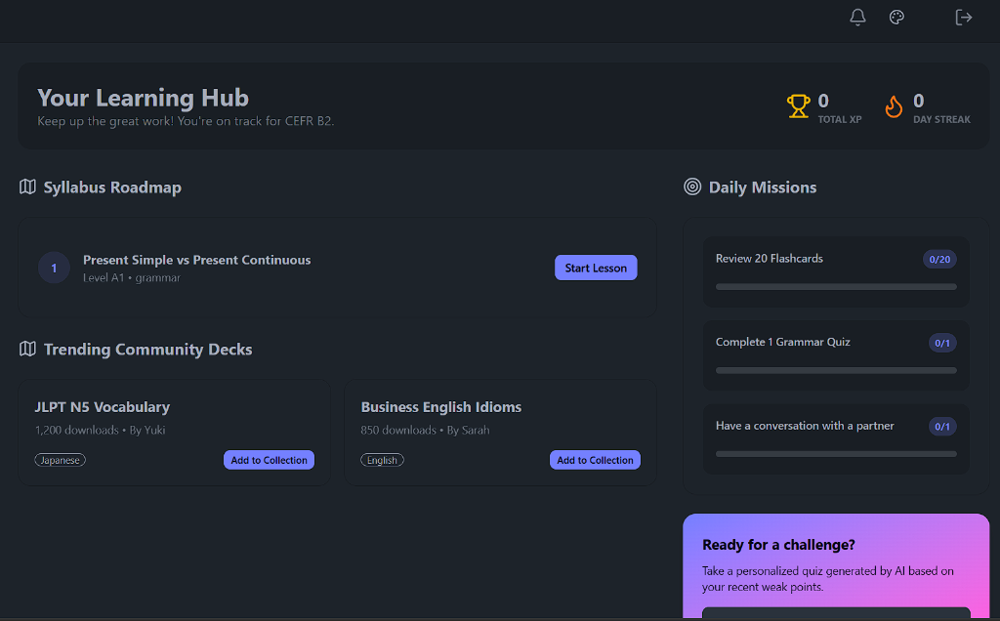
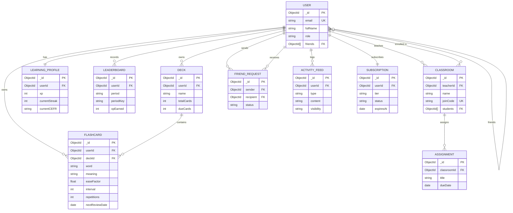

# Duffy

[](https://github.com/Slash-495/Duffy/actions/workflows/ci.yml)
[](LICENSE)

Duffy is a full-stack language learning platform that combines spaced-repetition flashcards (SM-2) with CEFR-adaptive Google Gemini AI coaching, real-time Stream WebRTC video/chat partner exchange, and educator classroom tools. Built with Node.js/Express and React 19, Duffy incorporates an optional Redis acceleration layer for real-time leaderboards and sliding-window rate limiting, automatically falling back to MongoDB and in-memory stores when Redis is offline.

**Live App:** [https://duffy.onrender.com/](https://duffy.onrender.com/)

---

## Screenshots

| Home & Partner Discovery | Learning Hub & Daily Missions |
| :---: | :---: |
|  |  |

| Immersive AI Roleplay | Global Leaderboard (Redis Sorted Sets) |
| :---: | :---: |
|  |  |

---

## Tech Stack

| Layer | Technologies |
|---|---|
| **Frontend** | React 19, Vite 6, Tailwind CSS, DaisyUI, TanStack Query v5, Zustand, React Router v7, Lucide Icons |
| **Backend** | Node.js (ESM), Express 4, Zod validation, Helmet (Report-Only CSP), `express-rate-limit` |
| **Database** | MongoDB, Mongoose 8 (compound indexes, cursor-based pagination) |
| **Caching & Acceleration** | Redis 7 (`ioredis`) — Sorted Sets, SHA-256 prompt cache-aside, Lua sliding-window rate limiter, TTL presence |
| **AI & Real-Time** | Google Gemini (`gemini-2.5-flash`), Stream Chat & WebRTC Video (`@stream-io/video-react-sdk`), Web Speech API |
| **Testing & CI** | Vitest, Supertest, `mongodb-memory-server`, GitHub Actions, Gitleaks |

---

## Quick Start

### Option A: Run with Docker Compose (Recommended)

Run the full stack (Frontend SPA, Backend API, MongoDB, and Redis) with a single command:

```bash
# 1. Clone repository
git clone https://github.com/Slash-495/Duffy.git
cd Duffy

# 2. Build and launch services
docker compose up --build
```
The application will be live at **`http://localhost:5001`** (the Express server serves the built frontend SPA and API routes).
*Note: The app is designed to start and function normally even if the Redis container is stopped.*

### Option B: Manual Local Setup

```bash
# 1. Clone repository
git clone https://github.com/Slash-495/Duffy.git
cd Duffy

# 2. Configure environment variables (placeholders provided in .env.example)
cp backend/.env.example backend/.env
cp frontend/.env.example frontend/.env

# 3. Start Backend (Terminal 1)
cd backend
npm install
npm run dev

# 4. Start Frontend (Terminal 2)
cd ../frontend
npm install
npm run dev
```

Frontend runs on `http://localhost:5173`, Backend API on `http://localhost:5001`.

---

## Testing

The backend test suite is powered by **Vitest**, **Supertest**, and **`mongodb-memory-server`** (running in native ESM mode with external network mocks and `REDIS_ENABLED=false` to verify fallback branches):

```bash
# Run backend test suite
npm test

# Run tests with code coverage report
npm run test:coverage --prefix backend

# Run frontend ESLint check
npm run lint --prefix frontend
```

---

## Key Design Decisions

Summary of Duffy's core system architecture (full write-ups in [`docs/DESIGN_DECISIONS.md`](docs/DESIGN_DECISIONS.md)):

1. **Redis Sorted Sets for Leaderboards (with MongoDB Durability)**
   - *Problem:* Calculating real-time global user rankings in MongoDB requires repeated collection scans and count queries.
   - *Solution:* Active leaderboard slices (`DAILY`, `WEEKLY`, `ALL_TIME`) are managed in Redis Sorted Sets (`ZINCRBY`, `ZREVRANGE`) with MongoDB as the durable store of record.
   - **Trade-off: Dual-write eventual consistency—XP is persisted to MongoDB first and Redis second without a distributed transaction, reconciled by `npm run rebuild:leaderboard`.**

2. **Tier-Based Sliding-Window Rate Limiting on Gemini Calls**
   - *Problem:* Upstream AI APIs enforce tight requests-per-minute quotas that basic IP limiters handle poorly across shared NAT networks.
   - *Solution:* Atomic Redis Lua scripts execute a rolling sliding-window check tailored to the user's tier (`FREE`: 10/15m, `PREMIUM`: 60/15m, `PRO`: 300/15m) with automatic in-memory fallback.
   - **Trade-off: Storing request timestamps in Sorted Sets uses slightly more memory than simple fixed-window counters to guarantee burst prevention.**

3. **Cache-Aside for Deterministic AI Prompts**
   - *Problem:* Learners frequently submit identical sentences for grammar checking and vocabulary translation, generating redundant upstream inference latency.
   - *Solution:* SHA-256 parameter hashes key parsed JSON results in Redis with a 24-hour TTL (`X-Cache: HIT | MISS`).
   - **Trade-off: Caching is strictly limited to deterministic prompts; dynamic multi-turn conversations and streaming SSE explanations are never cached.**

4. **Role-Based Access Control (RBAC) & Ownership Isolation**
   - *Problem:* Educational environments require segregating educator tools from student access while preventing horizontal resource manipulation.
   - *Solution:* Cookie-based JWT authentication backs `protectRoute` and `authorizeRoles("TEACHER", "ADMIN")`, while flashcard/deck queries enforce `{ _id, userId }` ownership filters.
   - **Trade-off: Stateless 7-day JWT cookies eliminate database lookups on every request but lack instant centralized revocation on logout.**

5. **CEFR-Adaptive AI Coaching Persona**
   - *Problem:* Generic AI prompts produce answers that are too difficult for beginner learners or too trivial for advanced speakers.
   - *Solution:* `RoleplayService` inspects the learner's `LearningProfile.currentCEFR` level (`A1`–`C2`) and injects level-tailored linguistic constraints into Gemini's system instructions.
   - **Trade-off: Injecting CEFR guidance adds ~60 prompt tokens per request to achieve pedagogically sound responses.**

---

## Data Model (Mongoose Schemas)

The following Mermaid entity-relationship diagram reflects the real Mongoose models in `backend/src/models`:



---

## Benchmarks Summary

Measured locally with [`autocannon`](benchmarks/runBenchmarks.js) against an isolated MongoDB Atlas cluster (**1,000 seeded users**) and local `redis-server` `v8.2.10` with zero error rates. Every request traverses Express middleware and authenticated JWT session verification:

| Endpoint | Baseline (`p50` / `p95` / `req/s`) | Accelerated (`p50` / `p95` / `req/s`) | Architectural Context |
|---|---|---|---|
| `GET /api/leaderboard?period=alltime&limit=20` | `700.21 ms` / `2,230.69 ms` / `10.88 req/s` | **`106.14 ms`** / **`150.88 ms`** / **`85.50 req/s`** | **Redis Sorted Sets:** Baseline is dominated by multiple sequential remote Atlas WAN network round-trips from a local test machine; Redis mode answers from memory. |
| `POST /api/ai/grammar` | `3,707.17 ms` / `4,011.41 ms` / `0.27 req/s` | **`103.88 ms`** / **`326.77 ms`** / **`64.00 req/s`** | **Cache Hit vs. Cache Miss:** Compares a live upstream Gemini 2.5 Flash API call against a local Redis cache hit; saves LLM token costs and avoids quota exhaustion. |

*Full methodology, test configurations, and reproduction instructions are documented in [`docs/BENCHMARKS.md`](docs/BENCHMARKS.md).*

---

## Known Limitations and Next Steps

- **Transcript-Based Pronunciation Scoring**: Evaluates browser Web Speech API STT transcripts with Gemini and text matching, rather than acoustic phoneme audio analysis.
- **JWT Session Invalidation**: Relies on client-side cookie removal on logout without a centralized Redis token revocation blocklist (`jti`).
- **Eventual Consistency on XP Writes**: XP awards are written to MongoDB and Redis sequentially without a multi-document distributed transaction (reconciled by `npm run rebuild:leaderboard`).
- **Single-Node Redis Topology**: Caching and sliding-window rate limiting operate against a standalone Redis instance rather than a Redis Cluster or Redis Sentinel deployment.
- **Free-Tier Gemini API Quota**: Upstream Gemini 2.5 Flash API free tier enforces tight RPM ceilings in development environments.
- **Realistic Next Steps**:
  1. Add native acoustic phoneme scoring using an open audio ML service.
  2. Implement a rotating refresh token flow paired with a Redis token blocklist.
  3. Integrate automated Stripe webhook handlers for self-serve subscription tier upgrades.

---

## License

This project is licensed under the MIT License — see the [LICENSE](LICENSE) file for details.

---

## Credits

Credit to **Codesistency** for the foundational MERN + Stream chat/video tutorial workflow. Built on top of that foundation in this repository:
- **AI Coaching & Immersion Layer:** `GeminiAdapter` with timeouts/retries, in-chat grammar/vocabulary/translation coaching, SSE nuance streaming, adaptive quizzes, CEFR-aware roleplay personas, and Web Speech transcript coaching.
- **Spaced Repetition & Gamification:** Deck/flashcard CRUD with SM-2 scheduling, XP/streak progression, daily missions, community activity feed, and multi-period leaderboards.
- **B2B / Classroom Tools & Security:** `TEACHER`/`ADMIN` RBAC, 6-character classroom join codes, cursor-paginated student rosters, assignments, Zod request validation, Helmet, and CORS allow-listing.
- **Redis System Design Layer:** Sorted-set leaderboards with MongoDB rebuild scripts, atomic Lua tier-based sliding-window rate limiting, SHA-256 prompt & hot-read cache-aside with write invalidation, and privacy-aware TTL online presence.
